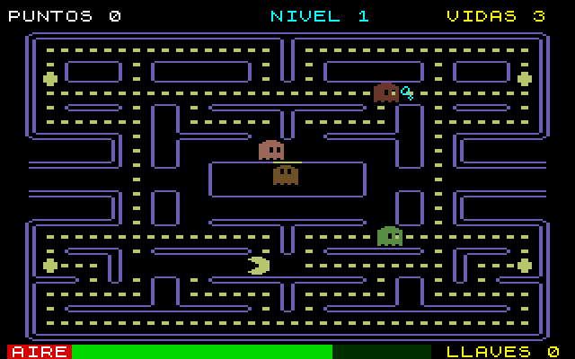
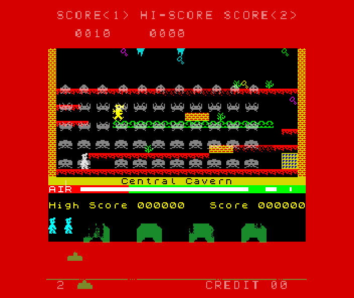
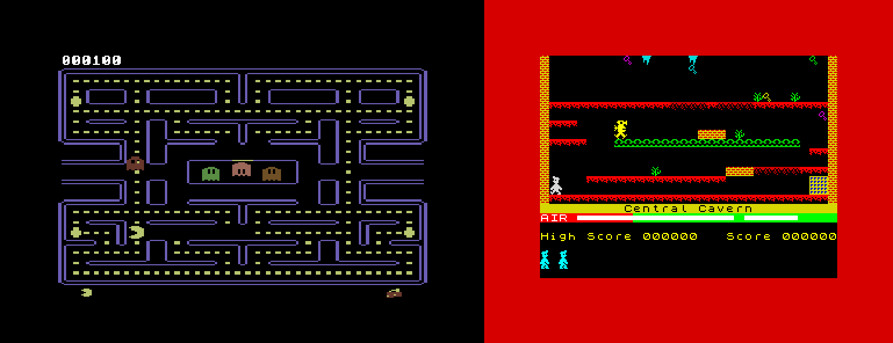

# RetroFusion

Emulador de computadoras y consolas de 8 bits (**RetroEmu**) que corre los juegos
originales con emulación real de CPU y hardware, y los **fusiona** con IA en juegos
nuevos: el estudio propone ideas, escribe el juego, lo prueba con jugadores robot y saca
versiones nuevas con lo que le pidas.

- Código del emulador y documentación completa: [emu/README.md](emu/README.md)
- Arquitectura: [emu/docs/ARQUITECTURA.md](emu/docs/ARQUITECTURA.md)
- El método para fusionar juegos: [emu/src/Retro.Studio/Docs/GUIA-FUSION.md](emu/src/Retro.Studio/Docs/GUIA-FUSION.md)
- Qué juegos conseguir para probar cada máquina: [emu/docs/JUEGOS-PARA-PROBAR.md](emu/docs/JUEGOS-PARA-PROBAR.md)

## Fusiones incluidas

Una muestra de lo que se puede hacer: cada fusión corre los juegos **originales** a la
vez, cada uno en su propia máquina emulada, y los conecta. Se juegan desde **Máquina >
Juegos que ya tienen fusión** si los juegos están en tu carpeta `ROMs`. Con **Fusión** podés
mezclar cualquier otro juego que el emulador corra.

### Manic Invaders — creado con IA

**Space Invaders** (arcade Taito, Intel 8080) + **Manic Miner** (ZX Spectrum 48K, Zilog Z80)


Una flota invasora se posa sobre la mina de Miner Willy. Con un láser que encontró en la
mina, Willy junta las llaves de cada caverna y escapa por el portal antes de que los
invasores aterricen o se le acabe el aire. Son las 20 cavernas originales y la flota del
arcade de verdad, que ahora apunta a Willy.

### Pac-Man en la Mina — creado con IA

**Pac-Man** (Commodore 64, MOS 6510) + **Manic Miner** (ZX Spectrum 48K, Zilog Z80)



Pac-Man cayó en la mina: casi no hay aire, cada punto le da un respiro y las llaves de la
mina le llenan los pulmones. El laberinto, los fantasmas y los niveles son los del Pac-Man
de C64; el aire, las llaves y el guardián vienen de Manic Miner. Cruza dos CPUs distintas.

### Invaders Miner — fusión clásica

**Space Invaders** (arcade Taito, Intel 8080) + **Manic Miner** (ZX Spectrum 48K, Zilog Z80), superpuestos



Willy recorre la Central Cavern mientras los invasores bajan encima de él. Los mismos
controles mueven al minero y al cañón. Cada invasor abatido le da aire a Willy; si Willy
muere, perdés una nave; juntar llaves te devuelve naves.

### Pac-Miner — fusión clásica

**Pac-Man** (Commodore 64, MOS 6510) + **Manic Miner** (ZX Spectrum 48K, Zilog Z80), lado a lado



Las flechas mueven a Pac-Man y a Willy a la vez. Cada vez que un fantasma atrapa a
Pac-Man, a Willy le falta el aire; cuando Willy junta una llave, Pac-Man gana una vida; si
Willy muere, Pac-Man también pierde una.

Las capturas son del emulador corriendo las fusiones con copias propias de los juegos; los
juegos no se incluyen.

## Usarlo

1. Bajá el paquete de **Releases** (Windows o Linux) y descomprimilo. No hace falta
   instalar nada.
2. Poné tus juegos en la carpeta `ROMs` (sueltos o en .zip). No se incluyen juegos: usá
   copias que tengas derecho a usar.
3. Tus juegos fusionados van en `Juegos fusionados` (cada juego es una carpeta con un
   `.json` y un `.js`; se pueden compartir).
4. Abrí `RetroEmu` y arrastrá un juego a la ventana, o usá **Máquina** y **Fusión**.

Para compilarlo desde el código hace falta el .NET SDK 10:

```bash
cd emu
dotnet build RetroEmu.slnx -c Release
dotnet run --project src/Retro.App -c Release
```

Las pruebas de conformidad grandes (6502) no están en el repositorio; se bajan con
`python emu/tools/bajar-pruebas-6502.py emu/testdata/6502`. Si faltan, esas pruebas se
omiten.

## Qué se incluye y qué no

- Se incluye la ROM del ZX Spectrum 48K (Amstrad permite distribuirla con emuladores) y
  las Open ROMs del Commodore 64 (libres, LGPL 3, con su licencia).
- No se incluye ningún juego ni otra ROM con copyright.
