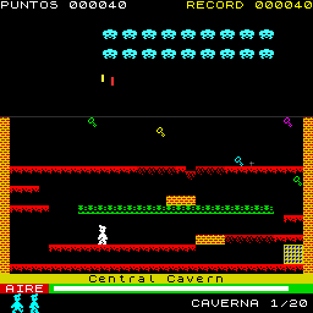
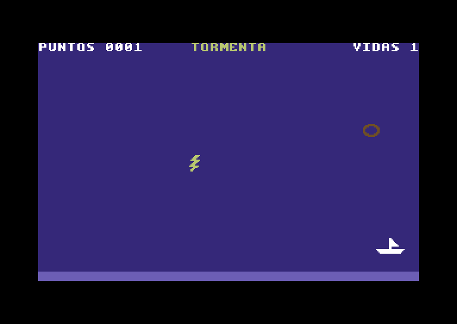
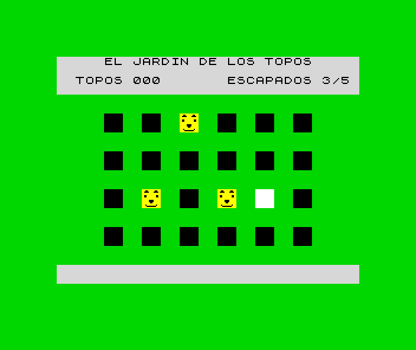
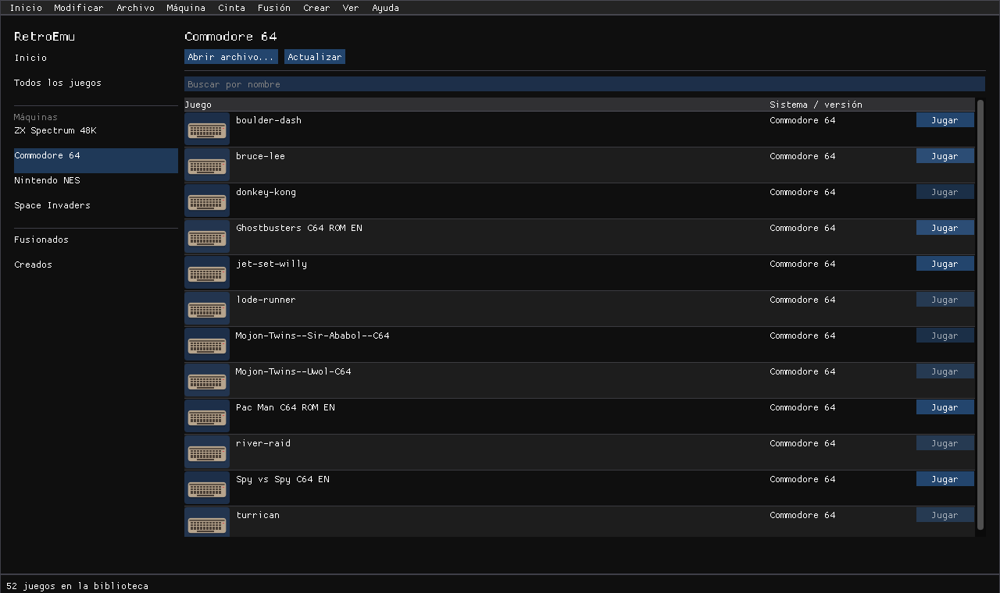
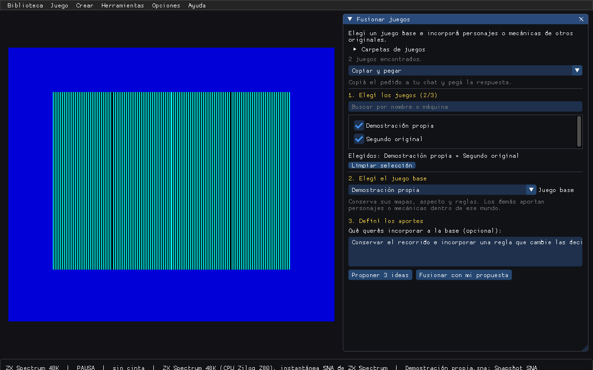
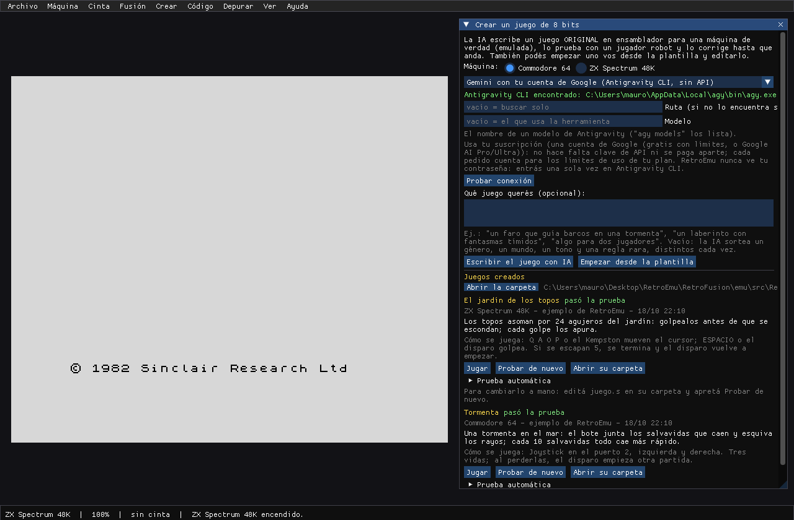
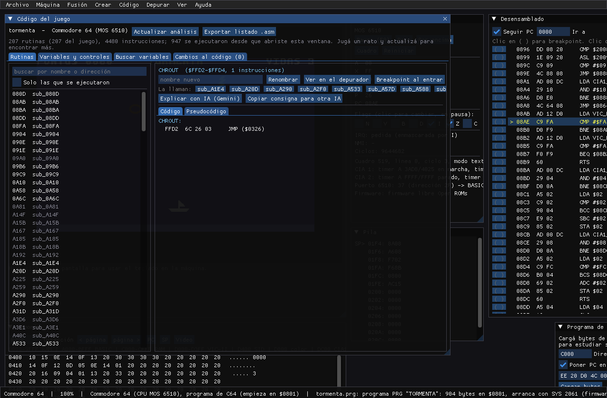
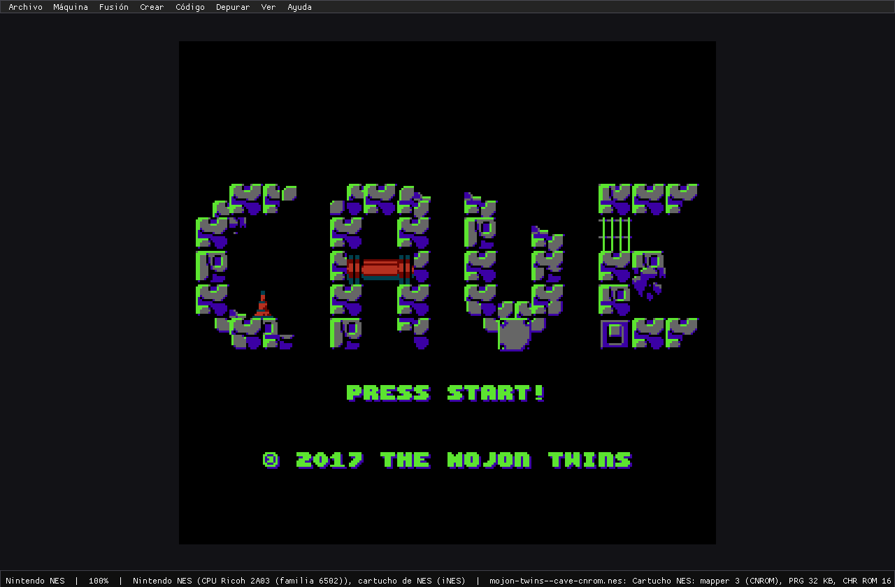

# RetroFusion

Emulador de computadoras y consolas de 8 bits (**RetroEmu**) que corre los juegos
originales con emulación real de CPU y hardware, y los **fusiona** con IA: elegís una
base y sumás mecánicas de otros juegos dentro de su mundo. El estudio propone aportes,
escribe el guion, lo prueba con jugadores robot y saca
versiones nuevas con lo que le pidas. También **crea juegos de 8 bits desde cero**: la IA
los escribe en ensamblador para un Commodore 64 o un ZX Spectrum emulados, un jugador robot
los prueba y quedan como un `.prg` o un `.tap` que corre en cualquier emulador.

- Código del emulador y documentación completa: [emu/README.md](emu/README.md)
- Arquitectura: [emu/docs/ARQUITECTURA.md](emu/docs/ARQUITECTURA.md)
- El método para fusionar juegos: [emu/src/Retro.Studio/Docs/GUIA-FUSION.md](emu/src/Retro.Studio/Docs/GUIA-FUSION.md)
- Qué juegos conseguir para probar cada máquina: [emu/docs/JUEGOS-PARA-PROBAR.md](emu/docs/JUEGOS-PARA-PROBAR.md)

## Fusiones incluidas

Los originales corren en sus máquinas emuladas. Podés conservar los mapas, gráficos,
interfaz y reglas de un **juego base** e incorporar personajes o mecánicas de los demás.
Invertir la base cambia la dirección de la fusión. **Reinterpretación libre** permite
una escena y un diseño nuevos si preferís esa opción.
Se juegan desde **Inicio > Fusionados** si los juegos están en tu carpeta `ROMs`.
Con **Fusionar juegos** elegís los originales, la base y los aportes. El guion puede
conservar la imagen nativa de esa base; no se admiten pantallas independientes pegadas.
Las instrucciones priorizan que los aportes tengan comportamiento y consecuencias en
el mundo conservado, sin añadir el mismo menú, HUD o estética a todas las combinaciones.

### Manic Invaders — creado con IA

**Space Invaders** (arcade Taito, Intel 8080) + **Manic Miner** (ZX Spectrum 48K, Zilog Z80)



Una flota invasora se posa sobre la mina de Miner Willy. Con un láser que encontró en la
mina, Willy junta las llaves de cada caverna y escapa por el portal antes de que los
invasores aterricen o se le acabe el aire. Son las 20 cavernas originales y la flota del
arcade de verdad, que ahora apunta a Willy.

Las capturas son del emulador corriendo las fusiones con copias propias de los juegos; los
juegos no se incluyen.

## Juegos de 8 bits creados desde cero

Menú **Crear > Juego de 8 bits nuevo**: elegís la máquina y, si querés, qué juego te
gustaría; la IA lo escribe en ensamblador con una guía del hardware, el emulador lo
ensambla, lo carga como cualquier juego y un jugador robot lo prueba; si algo falla, la IA
recibe el informe y una imagen de la pantalla y lo corrige. Sin pedido, cada vez parte de
una semilla distinta (género, mundo, tono y una regla rara). Funciona con tu IA por
suscripción o por API, copiando y pegando en un chat, o con un agente que trabaja en una
carpeta.

Estos dos vienen incluidos como ejemplo (originales, escritos solo con las guías):

| Tormenta (Commodore 64) | El jardín de los topos (ZX Spectrum) |
|---|---|
|  |  |
| Un bote junta salvavidas y esquiva rayos; sprites, sonido del SID y puntaje. | Golpear a los topos que asoman en 24 agujeros antes de que se escapen. |

## La app por dentro

**Modificar mientras jugás:** cambiá o congelá variables conocidas, pedí ideas a tu IA
y probalas con un punto de regreso. **Modificar > Variables y cambios divertidos**
(Ctrl+M). [Cómo usarlo](emu/docs/MODIFICACIONES.md).


| Elegir una máquina | Juegos de la máquina elegida |
|---|---|
|  |  |

Al abrirla elegís una máquina o **Todos los juegos**, buscás por nombre y pulsás **Jugar**.
**Fusionados** y **Creados** tienen sus propias secciones; los originales siguen disponibles.
Los archivos sueltos de `ROMs` se ordenan por sistema al detectarlos. Los que no se pueden
identificar quedan en su lugar; se conservan tus subcarpetas, fechas y nombres repetidos.
El selector muestra el hardware de cada máquina y las capturas o carátulas locales
de los juegos. Una imagen PNG o JPG con el mismo nombre junto al juego sirve como miniatura.
**Inicio** o **Ctrl+L** vuelve al selector y conserva la partida. El código y el depurador
se activan desde **Ver > Herramientas avanzadas**.

| Estudio de fusiones | Creador de juegos de 8 bits |
|---|---|
|  |  |
| Buscá y elegí los originales; pedí propuestas o escribí tu propia idea. | Partí de una idea o una plantilla; el emulador prueba el resultado. |

| Código y depurador | Nintendo NES |
|---|---|
|  |  |
| Estudiá rutinas, registros y memoria mientras el programa corre. | Juegos originales con CPU, video, sonido y controles emulados. |

## Usarlo

1. Bajá el paquete de **Releases** (Windows o Linux) y descomprimilo. No hace falta
   instalar nada.
2. Poné tus juegos en la carpeta `ROMs` incluida (sueltos, en subcarpetas o en .zip). No se incluyen juegos: usá
   copias que tengas derecho a usar.
3. `Juegos fusionados` y `Juegos creados` guardan las carpetas completas de tus juegos nuevos.
   Cada carpeta incluye una ayuda breve. Las bibliotecas existentes en una carpeta superior
   o en `Documentos/RetroEmu` se siguen usando mientras las nuevas solo tengan ayuda.
4. Abrí `RetroEmu`, elegí una máquina y pulsá **Jugar** en el título que quieras. También podés
   arrastrar un archivo o usar **Abrir archivo...**.

Para actualizar, cerrá el programa y copiá la entrega nueva sobre la anterior, combinando
las carpetas y conservando tus juegos y firmware. El paquete incluye `ACTUALIZAR.txt`.
**Ayuda > Conectar IA** muestra cómo instalar e iniciar sesión en cada herramienta,
y consulta sus modelos y esfuerzos disponibles. [Guía de conexión](emu/docs/CONECTAR-IA.md).
Los estados guardados se ofrecen en los originales; las fusiones se reinician desde el estudio.

Para compilarlo desde el código hace falta el .NET SDK 10:

```bash
cd emu
dotnet build RetroEmu.slnx -c Release
dotnet run --project src/Retro.App -c Release
```

Las pruebas de conformidad grandes (6502) no están en el repositorio; se bajan con
`python emu/tools/bajar-pruebas-6502.py emu/testdata/6502`. Si faltan, esas pruebas se
omiten.

## Qué se incluye y qué no

- Se incluye la ROM del ZX Spectrum 48K (Amstrad permite distribuirla con emuladores) y
  las Open ROMs del Commodore 64 (libres, LGPL 3, con su licencia).
- No se incluye ningún juego ni otra ROM con copyright.
