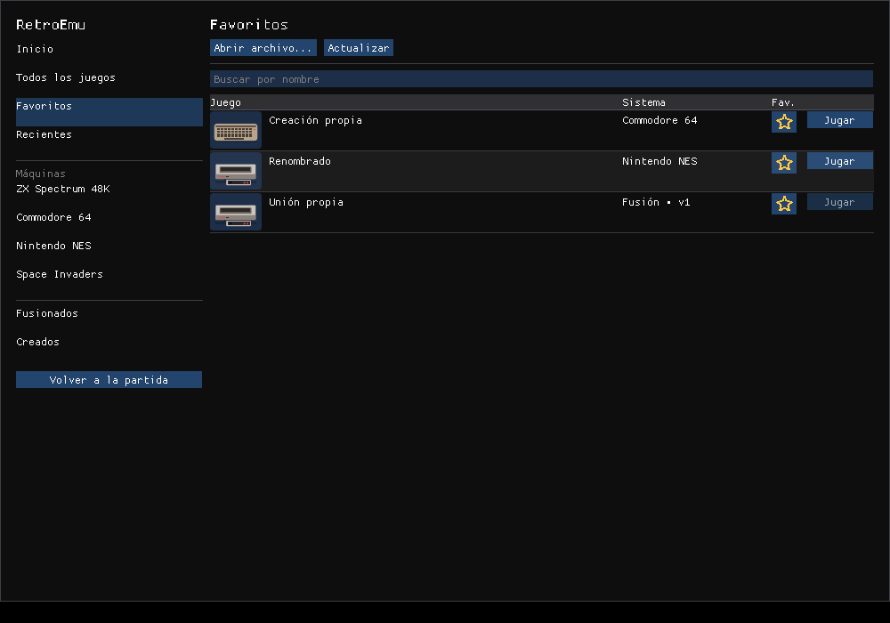
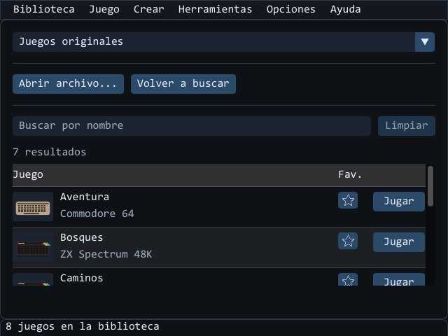
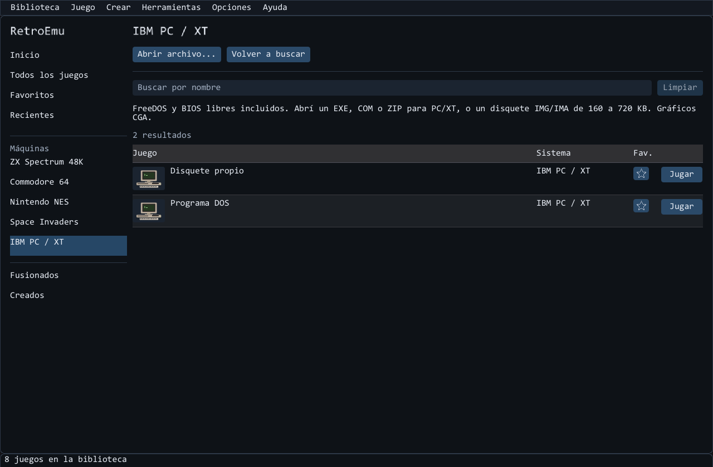

# RetroFusion

Emulador de computadoras y consolas de 8 bits (**RetroEmu**) que corre los juegos
originales con emulación real de CPU y hardware, y los **fusiona** con IA: elegís una
base y sumás mecánicas de otros juegos dentro de su mundo. El estudio propone aportes,
escribe el guion, lo prueba con jugadores robot y saca
versiones nuevas con lo que le pidas. También **crea juegos de 8 bits desde cero**: la IA
los escribe en ensamblador para un Commodore 64 o un ZX Spectrum emulados, un jugador robot
los prueba y quedan como un `.prg` o un `.tap` que corre en cualquier emulador.

- Código del emulador y documentación completa: [emu/README.md](emu/README.md)
- Arquitectura: [emu/docs/ARQUITECTURA.md](emu/docs/ARQUITECTURA.md)
- El método para fusionar juegos: [emu/src/Retro.Studio/Docs/GUIA-FUSION.md](emu/src/Retro.Studio/Docs/GUIA-FUSION.md)
- Qué juegos conseguir para probar cada máquina: [emu/docs/JUEGOS-PARA-PROBAR.md](emu/docs/JUEGOS-PARA-PROBAR.md)

## Fusiones incluidas

Los originales corren en sus máquinas emuladas. Podés conservar los mapas, gráficos,
interfaz y reglas de un **juego base** e incorporar personajes o mecánicas de los demás.
Invertir la base cambia la dirección de la fusión. **Crear > Juego nuevo con tus ROMs** es
un recorrido aparte para diseñar un juego nuevo con esos recursos.
Se juegan desde **Biblioteca > Fusionados** si los juegos están en tu carpeta `ROMs`.
Con **Fusionar juegos** elegís los originales, la base y los aportes. El guion puede
conservar la imagen nativa de esa base; no se admiten pantallas independientes pegadas.
Las instrucciones priorizan que los aportes tengan comportamiento y consecuencias en
el mundo conservado, sin añadir el mismo menú, HUD o estética a todas las combinaciones.
El alcance comprobado del motor está en [Pruebas de fusión](emu/docs/PRUEBAS-FUSION.md).

### Una fusión incluida


La fusión de ejemplo combina exploración de cavernas y defensa frente a una flota:
recoger objetos, atravesar plataformas y disparar forman parte de la misma partida.
Los originales se cargan desde la biblioteca del usuario; los juegos no se incluyen.

## Juegos de 8 bits creados desde cero

Menú **Crear > Juego nuevo desde cero**: elegís la máquina y, si querés, qué juego te
gustaría; la IA lo escribe en ensamblador con una guía del hardware, el emulador lo
ensambla, lo carga como cualquier juego y un jugador robot lo prueba; si algo falla, la IA
recibe el informe y una imagen de la pantalla y lo corrige. Sin pedido, cada vez parte de
una semilla distinta (género, mundo, tono y una regla rara). Funciona con tu IA por
suscripción o por API, copiando y pegando en un chat, o con un agente que trabaja en una
carpeta.

Estos dos vienen incluidos como ejemplo (originales, escritos solo con las guías):

| Tormenta (Commodore 64) | El jardín de los topos (ZX Spectrum) |
|---|---|
|  |  |
| Un bote junta salvavidas y esquiva rayos; sprites, sonido del SID y puntaje. | Golpear a los topos que asoman en 24 agujeros antes de que se escapen. |

## La app por dentro

**Investigar y modificar una partida:** pedile a tu IA que analice memoria y código,
revisá las variables y propuestas, y elegí qué aplicar. Podés congelar valores, deshacer
el último cambio o restaurar la partida. Podés guardar los análisis y las variables por
juego, y elegir si sus cambios se reaplican al reiniciar o volver a jugar. **Herramientas > Modificar y analizar** (Ctrl+M). [Cómo usarlo](emu/docs/MODIFICACIONES.md).


| Elegir una máquina | Juegos de la máquina elegida |
|---|---|
|  |  |

Al abrirla elegís una máquina o **Todos los juegos**, buscás por nombre y pulsás **Jugar**.
**Fusionados** y **Creados** tienen sus propias secciones; los originales siguen disponibles.
Marcá la estrella de un juego para guardarlo en **Favoritos**. **Recientes** reúne los
últimos juegos abiertos que siguen disponibles en tu biblioteca.



Los archivos sueltos de `ROMs` se ordenan por sistema al detectarlos. Los que no se pueden
identificar quedan en su lugar; se conservan tus subcarpetas, fechas y nombres repetidos.
El selector muestra el hardware de cada máquina y las capturas o carátulas locales
de los juegos. Una imagen PNG o JPG con el mismo nombre junto al juego sirve como miniatura.
**Biblioteca** o **Ctrl+L** vuelve al selector y conserva la partida. **Crear** reúne las
fusiones y los juegos nuevos; **Herramientas** reúne modificaciones, código y depurador.
**Opciones** contiene la conexión de IA, sonido y pantalla.

| Estudio de fusiones | Creador de juegos de 8 bits |
|---|---|
|  |  |
| Buscá y elegí los originales; pedí propuestas o escribí tu propia idea. | Partí de una idea o una plantilla; el emulador prueba el resultado. |

**Abrir construcción** muestra la actividad disponible de la herramienta. El tiempo restante se estima a partir de tus trabajos anteriores. **Uso de IA**
permite ajustar intentos y tope de texto, con una estimación orientativa y los tokens
que informe el proveedor. Si se interrumpe un trabajo automático, podés continuarlo
desde los pendientes del estudio o del creador con su último código y sus ediciones.

| Código y depurador | Nintendo NES |
|---|---|
|  |  |
| Estudiá rutinas, registros y memoria mientras el programa corre. | Juegos originales con CPU, video, sonido y controles emulados. |

| Biblioteca en una ventana chica | Programas de PC con arranque incluido |
|---|---|
|  |  |

## Novedades de la 0.3.1

- **Elegir programas de PC:** al abrir un ZIP con varios ejecutables aparece un selector
  con sus carpetas. Podés cambiar después desde **Juego > Programas del archivo**.
- **Archivos más ágiles:** las carpetas grandes dibujan solo las filas visibles; la búsqueda
  conserva sus resultados entre cuadros. **Enter** abre la selección y **Esc** cierra el selector.
- **Carga más confiable:** se corrigen colisiones de nombres DOS y rutas con signos de
  exclamación. Cancelar o rechazar un archivo conserva las opciones del juego anterior.
- Mantiene PC/XT con FreeDOS y CGA, NES con mappers 0/1/2/3/4/7 y cinco ranuras de
  guardado por juego. [Alcance de PC](emu/docs/PC-DOS.md).

## Usarlo

1. Bajá el paquete de **Releases** (Windows o Linux) y descomprimilo. No hace falta
   instalar nada.
2. Poné tus juegos en la carpeta `ROMs` incluida (sueltos, en subcarpetas o en .zip). No se incluyen juegos: usá
   copias que tengas derecho a usar.
3. `Juegos fusionados` y `Juegos creados` guardan las carpetas completas de tus juegos nuevos.
   Cada carpeta incluye una ayuda breve. Las bibliotecas existentes en una carpeta superior
   o en `Documentos/RetroEmu` se siguen usando mientras las nuevas solo tengan ayuda.
4. Abrí `RetroEmu`, elegí una máquina y pulsá **Jugar** en el título que quieras. También podés
   arrastrar un archivo o usar **Abrir archivo...**.

Desde la 0.2.1, el programa busca e instala actualizaciones al abrir. Conserva tus juegos,
firmware y ajustes, y vuelve a abrirse en la misma carpeta. Tus bibliotecas permanecen en su lugar.
La descarga y los temporales se eliminan al completar la actualización.
Podés omitir la actualización o cambiar esa opción en **Ayuda > Actualizaciones**.
Para pasar desde una versión anterior, seguí `ACTUALIZAR.txt` del paquete.
**Opciones > Conectar o configurar IA** muestra cómo instalar e iniciar sesión en cada herramienta,
y consulta sus modelos y esfuerzos disponibles. [Guía de conexión](emu/docs/CONECTAR-IA.md).
Al guardar sobre una ranura ocupada se pide confirmación.
Los estados guardados se ofrecen en los originales; las fusiones se reinician desde el estudio.

Para compilarlo desde el código hace falta el .NET SDK 10:

```bash
cd emu
dotnet build RetroEmu.slnx -c Release
dotnet run --project src/Retro.App -c Release
```

Las pruebas de conformidad grandes (6502) no están en el repositorio; se bajan con
`python emu/tools/bajar-pruebas-6502.py emu/testdata/6502`. Si faltan, esas pruebas se
omiten.

## Qué se incluye y qué no

- Se incluye la ROM del ZX Spectrum 48K (Amstrad permite distribuirla con emuladores) y
  las Open ROMs del Commodore 64 (libres, LGPL 3, con su licencia).
- No se incluye ningún juego ni otra ROM con copyright.
