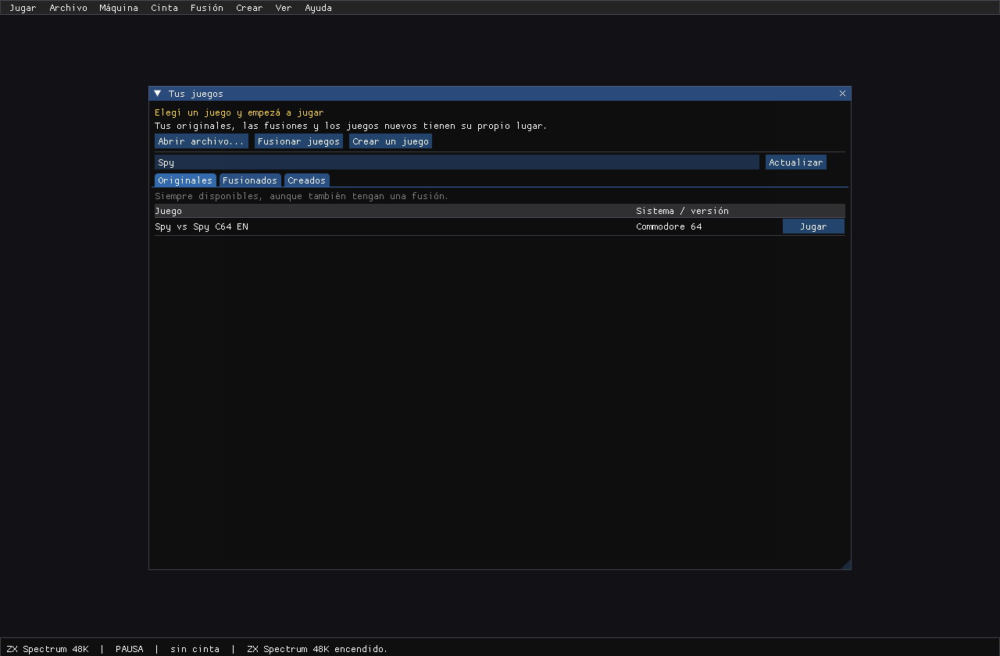
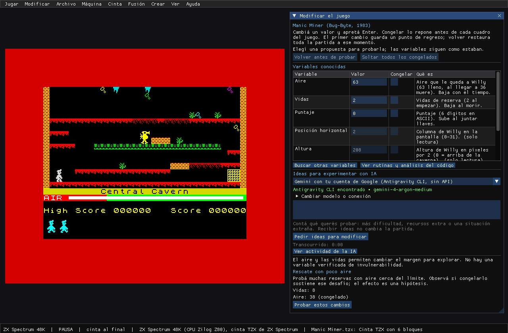

# RetroEmu

Jugá tus juegos originales, combiná sus reglas o creá un juego de 8 bits.

## Empezar

1. Abrí **RetroEmu.exe** en Windows o **RetroEmu** en Linux.
2. Elegí una máquina o **Todos los juegos**, buscá un título y pulsá **Jugar**.
3. Para agregar uno, usá **Abrir archivo** o arrastralo a la ventana.

El selector busca dentro de la carpeta actual: seleccioná y pulsá **Abrir** o **Enter**.
**Esc** lo cierra. Si un ZIP de PC trae varios programas, elegí el ejecutable al abrirlo;
**Juego > Programas del archivo** permite cambiar después.

El paquete trae estas carpetas junto al programa:

| Carpeta | Qué va ahí |
|---|---|
| **ROMs** | Tus juegos originales, sueltos o en ZIP; admite subcarpetas. |
| **Juegos fusionados** | Las carpetas completas de tus fusiones. |
| **Juegos creados** | Las carpetas completas de los juegos que creaste. |

Los juegos se consiguen por separado. Los originales siguen disponibles después de crear una fusión.
En una ventana chica, el selector superior reúne máquinas, favoritos, recientes y
juegos nuevos. Los títulos conservan espacio para leerse y los formatos pendientes
indican qué falta para abrirlos.

La estrella junto a cada juego lo agrega a **Favoritos**. **Recientes** muestra los
últimos juegos abiertos disponibles en tu biblioteca; podés vaciar la lista sin borrar
juegos ni favoritos. Se conservan al cerrar o actualizar el programa.

Los archivos sueltos de **ROMs** se ordenan automáticamente por sistema. Los dudosos
quedan donde están; se respetan tus subcarpetas y los archivos con nombres repetidos.
Para mostrar una carátula o captura, poné una imagen PNG o JPG con el mismo nombre
junto al juego. Si no hay imagen, se muestra el sistema al que pertenece.
Desde la 0.2.1, RetroEmu busca e instala actualizaciones al abrir y conserva tus juegos,
firmware y ajustes. **Ayuda > Actualizaciones** permite buscar, omitir o desactivar
la instalación automática. Si venís de una versión anterior, seguí **ACTUALIZAR.txt**.

El estudio muestra una estimación antes de empezar. **Preparar y crear esta fusión**
investiga los datos pendientes en varias rondas y continúa con la creación cuando
hay evidencia suficiente. Puede trabajar hasta una hora en total; si al escribir
aparece otro faltante, vuelve a investigarlo. Podés ver el avance y cancelar.
[Preparación automática y tiempos](docs/PREPARAR-FUSION.md).

## Sonido y pantalla

En **Opciones > Sonido > Volumen y opciones** ajustás volumen, silencio al cambiar
de ventana y margen de audio. Los cambios se conservan al cerrar.
**Opciones > Pantalla** reúne pantalla completa y escala entera.
[Opciones de sonido](docs/SONIDO.md) · [Novedades de 0.3.2](docs/NOVEDADES-0.3.2.md).

## Durante la partida

Hacé clic en la pantalla para usar el teclado. **Ayuda > Controles de la partida**
muestra las teclas del juego o sistema activo. También se puede usar un mando.

| Atajo | Acción |
|---|---|
| Ctrl+L | Volver a Inicio |
| Ctrl+O | Abrir un archivo |
| Ctrl+M | Modificar la partida |
| F2 | Guardar estado rápido |
| F3 / F4 en C64 | Cargar estado rápido |
| F8 | Turbo |
| F9 | Pausa |
| F11 | Pantalla completa |

Las cintas pueden tardar en cargar. Si el joystick del C64 no responde,
cambiá el puerto en **Juego > Controles y hardware**.
**Juego > Partidas guardadas** ofrece cinco ranuras por juego y edición, con fecha.
Al guardar sobre una ranura ocupada, confirmá si querés reemplazarla.
Los estados guardados están disponibles en originales. Si un estado está dañado,
la partida actual se conserva.

## Fusionar o crear

- **Fusionar juegos:** elegí 2 o 3 originales y cuál es la base. Conserva sus mapas,
  aspecto y reglas, con personajes o mecánicas de los otros dentro de ese mundo.
- **Crear > Juego nuevo con tus ROMs:** diseñá un juego nuevo con esos recursos, sin una base obligatoria.
- **Crear > Juego nuevo desde cero:** elegí la máquina y describí lo que querés. Podés dejar la idea a elección de la IA.
- **Cambiar una fusión:** pedí otra versión desde el estudio. Las anteriores quedan guardadas.

Elegí cómo trabajar: una herramienta instalada con tu sesión iniciada, copiar y pegar
desde un chat, una carpeta para tu agente o una API. Las APIs tienen sus propias
condiciones y cargos. Las herramientas instaladas usan los límites de tu cuenta.
**Opciones > Conectar o configurar IA** guía la instalación y el acceso; después muestra los modelos
y esfuerzos que publica cada herramienta. [Ver los pasos](docs/CONECTAR-IA.md).

Si cerraste el panel durante un pedido, **Ver trabajo en curso** permite volver a él.
Durante un pedido, **Abrir construcción** muestra la actividad disponible y permite cancelar.
El progreso muestra el tiempo transcurrido y un estimado orientativo cuando hay historial suficiente.
**Uso de IA** permite ajustar los intentos y el tope de texto. Los trabajos interrumpidos
del estudio y del creador aparecen como pendientes para continuar.
Los juegos nuevos se guardan en las carpetas incluidas. Si ya tenés una biblioteca
en una carpeta superior o en **Documentos/RetroEmu**, se sigue usando mientras las
carpetas nuevas solo tengan ayuda.

## Modificar

**Herramientas > Modificar y analizar** o **Ctrl+M** reúne los cambios, el análisis con IA,
la búsqueda de variables y las herramientas de código. La IA puede investigar una partida
sin perfil previo; sus hallazgos aparecen como hipótesis para probar.
**Conservar análisis y cambios de este juego** guarda lo encontrado para volver a usarlo.
La reaplicación al reiniciar o abrir el juego se activa por separado.
**Deshacer último cambio** conserva hasta cinco cambios; **Restaurar partida** vuelve al primero.
[Ver las opciones de modificación](docs/MODIFICACIONES.md).

## Sistemas y archivos

| Sistema | Archivos |
|---|---|
| ZX Spectrum 48K | TAP, TZX, Z80, SNA |
| Commodore 64 | T64, PRG |
| NES | NES, mappers 0/1/2/3/4/7 |
| IBM PC / XT | EXE/COM y ZIP con FreeDOS y BIOS libres incluidos; también IMG/IMA de 160–720 KB |
| Placa arcade Taito/Midway 8080 | Conjunto de ROMs de la placa en ZIP |

También se aceptan archivos ZIP. La compatibilidad depende de la edición del juego.
El paquete incluye el firmware redistribuible del Spectrum y Open ROMs para C64,
con sus licencias en **firmware**. PC/XT incluye GLaBIOS, FreeDOS y FreeCOM,
con licencias y fuentes en **system/pcxt**. [Procedencia](docs/TERCEROS.md).

En PC/XT, F1–F10 llegan al juego: los atajos del emulador usan Ctrl+Fn y los de
herramientas Ctrl+Shift+letra. [Preparar PC y DOS](docs/PC-DOS.md). El análisis de
variables y las fusiones de PC todavía no están disponibles.

El visor de código está en la misma ventana de modificaciones. El depurador se abre
desde **Herramientas** o con **F12**.
