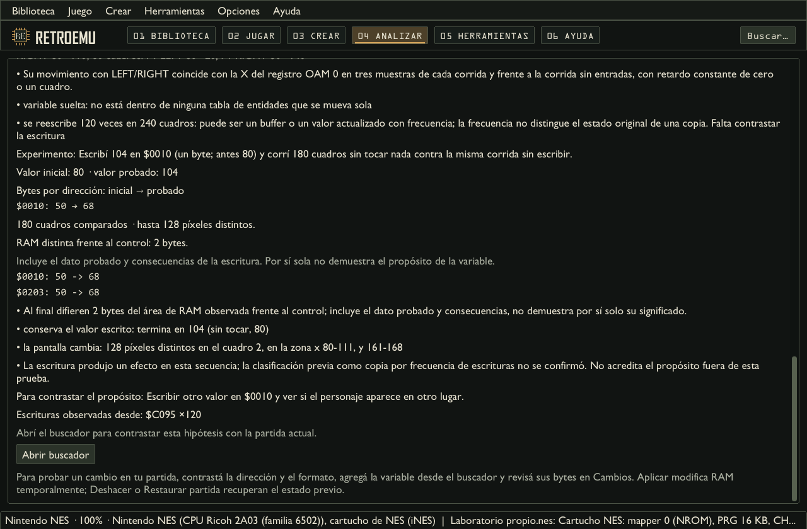

# Investigar variables sin jugar primero

Abrí un original y elegí **Herramientas > Investigación automática**. También está en
**Analizar > Análisis con IA**, con el modo automático seleccionado. La observación
avanzada y el buscador manual permiten contrastar situaciones concretas.
El laboratorio admite Spectrum 48K, C64, NES y la placa arcade implementada;
PC/XT conserva código y depurador, sin este laboratorio.

El programa crea máquinas privadas, arranca el original y reproduce entradas controladas.
Compara memoria, imágenes y escritores observados; prueba candidatos desde un mismo
estado, con una corrida de control y otra modificada. No requiere que el usuario gane
puntos, pierda vidas o juegue antes. Un juego que el robot todavía no logra arrancar o
controlar devuelve un resultado parcial con la evidencia y el problema observado.
Si ya hay un arranque en el perfil, el laboratorio lo prueba primero en una máquina
privada y contrasta sus controles. Un nombre de archivo puede proponer ese arranque;
los datos de memoria anteriores sólo se reutilizan para la edición exacta.

## Objetivo, presupuesto y continuación

La descripción es opcional: por ejemplo, «contrastar salto, velocidad y reloj». La cantidad
deseada cuenta **efectos de escritura comprobados**, sin garantizar encontrarlos ni
certificar su significado. El laboratorio también busca movimiento, físicas, enemigos,
temporizadores, dificultad y estados cuando hay señales observables.

En **Presupuesto de IA** se eligen minutos, pedidos, rondas y cuadros de
observación. Con cero pedidos se ejecutan pruebas locales; una conexión manual también
ejecuta solo esas pruebas. Una CLI o conexión automática puede proponer entradas y nombres.
Todas las consultas de navegación, experimentos y nombres comparten el tope de pedidos.
El tope de texto cuenta pedidos enteros; no corta instrucciones para hacerlos entrar.
Los tokens son los informados por el proveedor, cuando existen, y no son un saldo de cuenta.

La pantalla muestra etapa, tiempo, rondas completadas, candidatos y efectos comprobados.
No calcula un porcentaje de descubrimiento. Dos rondas sin datos nuevos detienen la
repetición. El límite de tiempo, un error o **Pausar análisis** conservan lo
ya completado; una prueba interrumpida puede repetirse al continuar.

**Continuar análisis** agrega el presupuesto indicado de minutos y pedidos al trabajo guardado.
El tiempo y los pedidos acumulados siguen visibles. Abrir un guardado no ejecuta análisis.
Cerrar el panel permite seguir trabajando; cambiar de juego detiene el análisis anterior
y evita que sus resultados aparezcan en la partida nueva.

## Interpretar los resultados

Vista con un programa propio de prueba: los bytes de la dirección investigada y una
copia se comparan con la corrida de control. No es evidencia de un juego comercial.

Cada candidato muestra dirección, tamaño, codificación, hipótesis y evidencia. La prueba
registra valor y bytes iniciales, valor y bytes escritos, cuadros comparados, diferencias
de imagen y diferencias finales en el área de RAM observada. Esa muestra incluye tanto
el dato probado como consecuencias: no atribuye por sí sola el propósito de cada byte.
Que el juego reescriba enseguida un dato puede indicar una copia o un valor derivado;
esa conclusión queda limitada a la secuencia probada.
Los relojes decimales se examinan también como campos completos de varias cifras.
La evidencia puede informar intervalos entre descensos, medidos en cuadros; una unidad
del contador no se convierte en un segundo por su nombre. La escritura completa debe
contrastar acarreo, préstamo, límites y vencimiento antes de usarse en una regla.
Los perfiles automáticos conservan **propósito propuesto** aunque se haya comprobado
un efecto al escribir. Cambios y los pedidos a la IA mantienen esa distinción; los
perfiles antiguos con nombres de IA tampoco se convierten en certificados al abrirlos.
Una frecuencia alta de escrituras no alcanza para descartarlo: el laboratorio también
contrasta esos candidatos. En ventanas chicas, Cambios presenta los campos uno debajo
del otro y destaca los bytes que difieren, con la misma prueba y reversión.

**Efecto de escritura comprobado** significa que el experimento observó un efecto, no que
el nombre propuesto por IA sea correcto. **Hipótesis**, **sin concluir** y **refutado por
la prueba** permanecen separados. Una explicación convincente no convierte un candidato
en una variable del perfil. Tras un cambio de motor o perfil, los efectos anteriores
requieren nuevo contraste y no cuentan como verificados actuales.

**Abrir buscador** prepara la búsqueda en la partida actual. Seguí los
pasos indicados, comprobá formato y rango, y agregá la variable cuando corresponda.
En **Cambios**, revisá dirección y bytes actuales → propuestos antes de aplicar.
**Deshacer** o **Restaurar partida** recuperan el estado anterior. Aplicar y congelar
modifican RAM temporal; los parches de código tienen su herramienta separada.
El análisis automático no parchea los archivos.

## Guardados y límites

Los checkpoints privados están junto al original, en `.retroemu/analisis`: hasta doce
análisis, cuatro MB por archivo y un estado de continuación acotado. Se guarda el objetivo
antes de empezar y la evidencia al completarse etapas. Las escrituras son atómicas y
usan un bloqueo de carpeta; un fallo conserva el checkpoint anterior y se informa.
No se reemplazan análisis antiguos para hacer lugar. **Administrar guardados** permite
elegir y confirmar qué progreso descartar.

Al continuar se comprueban SHA-256 del archivo contenedor y firmware. En archivos con
varias ediciones, el perfil identifica por hash el miembro seleccionado. Un cambio de
original, firmware o miembro seleccionado impide mezclar la investigación. La identidad
del motor incluye CPU, hardware y laboratorio; sus cambios o los del perfil invalidan
la continuación de máquina. La vista marca los efectos anteriores como históricos al
abrirlos y conserva las comprobaciones de arranque/entradas. Un archivo ilegible queda
conservado con un aviso.
Los guardados no imponen rutas externas de origen ni promueven perfiles automáticamente.

La cobertura depende del hardware, el arranque reproducible y los experimentos disponibles.
No hay cantidad garantizada ni detección universal de reglas. La semántica de salto, daño,
progresión o victoria requiere evidencia específica; calidad visual, ritmo y diversión
tampoco quedan certificados por una comparación de memoria.
