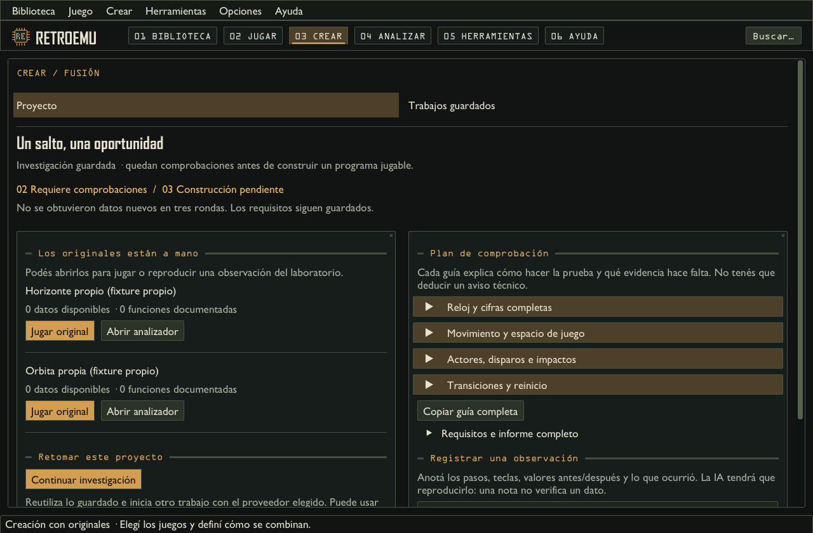

# Preparar los datos para una fusión

Antes de empezar, el estudio muestra un tiempo orientativo para preparar los originales,
crear la fusión y comprobarla. Con datos pendientes estima 20–60 minutos para dos
originales y 30–60 para tres. Con los datos disponibles, estima 5–20 minutos. Puede
terminar antes; la velocidad de la IA, las ediciones y la dificultad de las pruebas
cambian esos tiempos. Si aparecen nuevos requisitos, puede extender la investigación
dentro de la misma hora de trabajo.

Cuando ya hay tres creaciones completas comparables con la misma configuración de IA,
el intervalo usa sus duraciones locales. Los trabajos cancelados, fallidos o rechazados
al guardar no cuentan. Sin ese historial se mantiene la orientación general anterior;
consultar la estimación no envía pedidos a la IA.

## Un trabajo continuo

**Preparar y crear esta fusión** conserva la idea, los originales, el juego base y los
aportes elegidos. Con una IA conectada, arranca los originales y prueba controles,
busca variables y contrasta las hipótesis con lo que ocurre en el juego. Después
revisa qué requisitos siguen pendientes y usa esa información para otra ronda.

La siguiente ronda puede retomar el punto alcanzado en la partida de investigación.
La IA recibe las pruebas anteriores y sus resultados para cambiar de estrategia,
explorar otras zonas o provocar otros eventos. Los perfiles conservan lo que ya se
comprobó para esa edición.

Cuando hay evidencia suficiente, continúa con la escritura y la validación. Si al
escribir aparece otro dato pendiente, vuelve a investigarlo automáticamente y retoma
el trabajo. No hace falta volver a pulsar el botón por cada faltante.

La investigación puede arrancar los originales, ensayar entradas y comparar ejecuciones
sin pedirte una partida manual como condición previa. Una cantidad objetivo de variables
orienta la búsqueda; aumentar el tiempo o los pedidos no garantiza encontrar esa cantidad
ni resolver todos los requisitos de una idea.

## Qué demuestra cada comprobación

Llegar al título, responder a los controles y repetir el arranque en una máquina nueva
son comprobaciones distintas. El laboratorio conserva candidatos y los contrasta desde
el mismo estado, con y sin entradas o escrituras. El informe distingue una hipótesis,
un efecto de escritura observado y el significado propuesto de una variable. Que una
escritura se conserve, cambie RAM o altere píxeles no confirma por sí solo posición física,
colisión, daño, cámara ni progreso.

Después de escribir, la prueba técnica de la fusión ejecuta patrones de entrada quieto,
explorador y tirador. Comprueba errores, estados informados por el guion, comienzo y
reinicio cuando se alcanzan, imagen y restricciones de la escena base. Los puntos y
las muertes se observan cuando existen: no sumar puntos es una observación, no obliga a
inventar un marcador ni a cambiar de género para aprobar.

Para evaluar la experiencia hace falta contrastar el diseño con situaciones concretas:
si se entiende la acción, si sus consecuencias son visibles, si los controles permiten
progresar y si una regla del aportante cambia una decisión de la base. Comparar esa
situación con la misma sin el aporte ayuda a comprobar la unión mecánica. El trabajo
autónomo puede preparar y ejecutar estos contrastes; lo que no se observó queda pendiente.
Una prueba técnica aprobada no certifica fidelidad visual, equilibrio, originalidad ni
diversión. Las valoraciones se distinguen de las observaciones reproducibles.

## Tiempo, progreso y cancelación

El trabajo automático puede dedicar hasta una hora al conjunto de preparación,
referencias, escritura y comprobaciones. Reserva parte del tiempo para terminar el
juego; las etapas no reciben una hora nueva al empezar. El modo de ahorro conserva
su número de intentos de escritura y el límite de texto elegido.

El reloj muestra el tiempo total de ese trabajo: no vuelve a cero al pasar de
preparación a referencias, escritura o una investigación adicional. El tiempo restante
también respeta el máximo de una hora.

La pantalla informa qué original se está investigando; el plan conserva los requisitos completos. Podés abrir
la actividad de la IA o cancelar, incluso durante la prueba técnica de la fusión. Los perfiles de las rondas completadas quedan
guardados y los borradores de escritura siguen disponibles en trabajos pendientes.
La idea y las identidades de los originales se guardan antes de investigar. Después de
cada original y revisión se conservan los avances completados en un checkpoint privado.
Cancelar conserva esos puntos, incluso si el siguiente original aún no terminó. El trabajo
actual no completado puede necesitar repetirse; cerrar no fabrica una partida del jugador.
El reloj se detiene al terminar o pausar esa investigación.

## Pedidos, texto y tokens de IA

Los límites de pedidos y texto se comprueban antes de enviar cada solicitud completa;
no se recorta el código ni el contrato para hacerla entrar. Un pedido enviado cuenta
como intento aunque falle. El texto acumulado se conserva al retomar el trabajo; abrir
un pendiente no inicia pedidos. Las correcciones llevan el último borrador y el objetivo,
sin acumular todas las versiones anteriores. Repetir un guion ya fallido detiene ese ciclo.

El texto medido localmente y los tokens informados por el proveedor son datos distintos.
La CLI puede añadir contexto propio; las imágenes y la salida también tienen consumo que
el contador de caracteres no mide. Si falta metadata, el consumo queda desconocido o
parcial. Los tokens de entrada en caché ya forman parte de la entrada informada: no se
suman otra vez. Estos contadores no representan saldo de cuenta, precio ni cuota restante.

En la API, `AiOperation` serializa las solicitudes de una misma instancia. Esperar en su
cola y cancelar antes de enviar no reserva pedidos ni texto. Una respuesta vacía falla;
un fallo no vuelve a sumar los contadores que quedaron de la llamada anterior. Si el
proveedor informa consumo nuevo antes de fallar, se conserva esa metadata. Operaciones
distintas y llamadas directas que compartan un proveedor necesitan coordinación propia;
esta serialización no es un bloqueo global de la cuenta.

La caché local de arranque del emulador es independiente de la caché de tokens. Reutiliza
estados solo para el mismo contenido, perfil y firmware; no demuestra que una hipótesis
sea correcta ni evita por sí sola nuevos pedidos a la IA.

## Si todavía falta información

Vista de prueba con programas propios; no representa una fusión terminada.

Una posición observada no demuestra por sí sola cámara, colisiones, daño ni progreso.
El estudio conserva los requisitos hasta respaldarlos. Puede detenerse al alcanzar el
tiempo disponible, ante un fallo de arranque, cuando la IA no encuentra pruebas nuevas
ni datos nuevos, o si la escritura insiste en el mismo bloqueo sin evidencia adicional.
Tres rondas sin cambios en los datos detienen la repetición: ejecutar otra prueba sin
obtener evidencia no cuenta como avance. El informe conserva los avances y explica el motivo.

En **Trabajos guardados > Ver investigación** aparecen los originales con **Jugar original**
y **Abrir analizador**, las comprobaciones disponibles y un plan por tema: reloj, movimiento,
actores y transiciones. Cada guía explica la prueba y la evidencia requerida; también se
puede copiar completa. **Guardar observación** conserva una nota para reproducir y contrastar.
**Continuar investigación** inicia otro trabajo con el proveedor elegido y reutiliza lo
guardado; no se ejecuta automáticamente al abrir la aplicación ni promete completarlo.
Si ya comenzó la escritura, retoma el borrador asociado.

**Buscar investigaciones de versiones anteriores** recupera objetivos comunes de los
registros de laboratorio. Se revisan como propuestas: los registros pueden estar recortados
y no conservan necesariamente la base ni el orden de los originales. No recupera código
que nunca se guardó. El usuario revisa la selección y vuelve a proponer o preparar la idea.

Los checkpoints están en `ROMs/.retroemu/investigaciones` junto a la carpeta elegida de
originales. Son privados: contienen el objetivo, rutas, hashes, perfiles, resultados y
estados de laboratorio; no incluyen los archivos ROM, capturas ni salida de proveedores.
Hay hasta doce trabajos de 4 MB cada uno. No se borra un trabajo anterior para hacer lugar.
No se suben ni se distribuyen. No los confundas con los estados personales de partida.

Un cambio de motor o perfil descarta la continuación de máquina que ya no corresponde;
se preserva la propuesta y se vuelve a comprobar desde los datos actuales. Un cambio de
edición o firmware impide reutilizar ese punto. Los perfiles automáticos pueden recuperar
funciones curadas solo si coincide el hash del programa completo de una edición conocida.

Cambiar los originales, sus perfiles, el firmware o la configuración invalida resultados
que ya no correspondan. Esto también se comprueba cuando la idea entra directamente
a crear, sin preparación previa. Si los datos cambiaron desde que se eligieron,
actualizá la biblioteca y elegí la idea de nuevo. Durante la escritura se conserva
una copia privada de los datos; antes de guardar se comparan con los archivos actuales.
El borrador permanece pendiente si el guardado se rechaza. La preparación usa máquinas
de investigación y no modifica las ROMs.

En intercambio manual o por carpeta, el chat o agente tiene que responder a las
consignas. Ese modo no simula una revisión automática.

Al crear o corregir una fusión también se pueden guardar recorridos de entradas:
el emulador los repite y compara cambios de memoria del original, además de los robots
generales. El informe muestra lo observado y las discrepancias que vuelven a corrección.
Si faltan datos para comprobar una regla, debe decirlo; pasar unos casos no demuestra
todos sus niveles o finales. El [formato de recorridos](../src/Retro.Studio/Docs/GUIA-FUSION.md#recorridos-dirigidos)
sirve también en `juego.json` de la carpeta del agente.

No comprobar un movimiento no demuestra que el juego siga en el título. Puede usar
otras teclas o movimientos que la prueba general no reconoce. En Spectrum se prueban
también pares de letras; si solo se reconoce un eje, el perfil no inventa un disparo.

[Volver al mapa](https://github.com/mauroalvare/RetroFusion/blob/main/emu/docs/MAPA.md) · [Límites actuales](https://github.com/mauroalvare/RetroFusion/blob/main/emu/docs/LIMITACIONES.md) ·
[Cómo se diseña una fusión](https://github.com/mauroalvare/RetroFusion/blob/main/emu/src/Retro.Studio/Docs/GUIA-FUSION.md)
